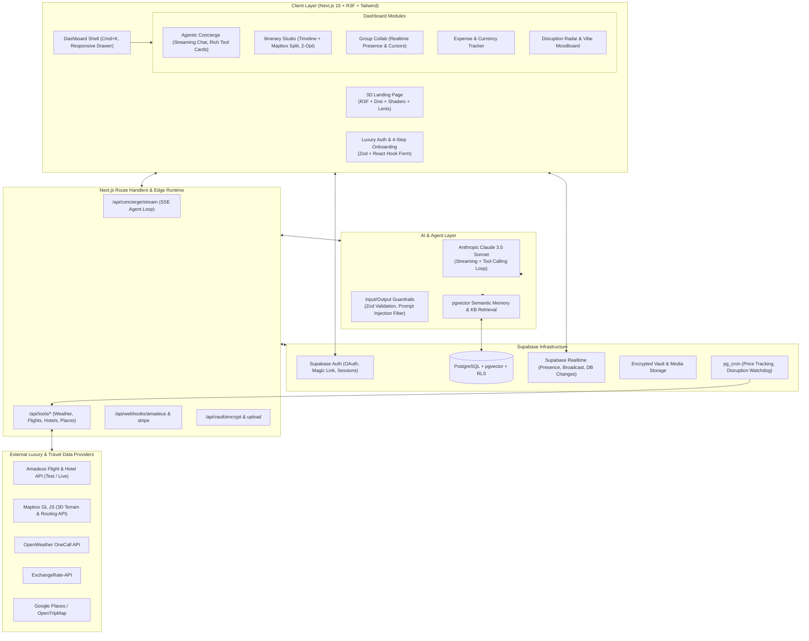
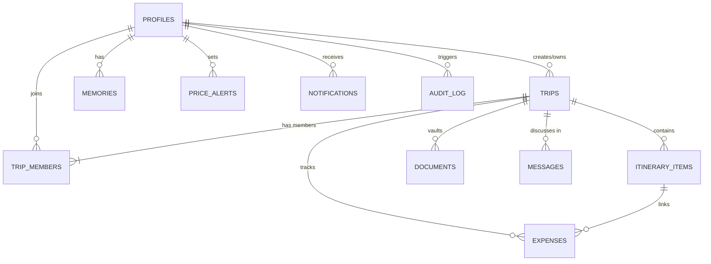

# Voyara System Architecture & Technical Specifications

> **Platform:** Voyara — Luxury AI-Powered Travel Concierge  
> **Architecture Version:** 1.0.0-PROD  
> **Target Performance:** First paint < 200KB gz, LCP < 2.5s, Time-to-Itinerary < 60s, WCAG 2.2 AA compliant.

---

## 1. System Architecture Diagram



---

## 2. Directory & Modular File Structure

The project follows a modular, feature-driven architecture under `src/features/` with strict separation of concerns, complete TypeScript typing, and shared UI primitives.

```
voyara/
├── .github/
│   └── workflows/
│       ├── ci.yml                 # Lint, Typecheck, Unit Tests, Build
│       └── e2e.yml                # Playwright E2E matrix
├── docs/
│   ├── ARCHITECTURE.md            # Complete architecture & design specs
│   └── API_CONTRACTS.md           # Route handlers & Tool JSON schemas
├── public/
│   ├── models/                    # Draco-compressed GLTF/GLB models (Earth, pin)
│   ├── textures/                  # KTX2/WebP night-lights & earth normal maps
│   ├── audio/                     # Subtle ambient UI feedback chimes
│   └── fonts/                     # Cormorant Garamond & Inter variable fonts
├── supabase/
│   ├── config.toml
│   ├── migrations/
│   │   ├── 20261017000001_initial_schema.sql
│   │   ├── 20261017000002_rls_policies.sql
│   │   └── 20261017000003_pgvector_memories.sql
│   └── seed.sql                   # Luxury destinations & seeded RAG knowledge
├── src/
│   ├── app/
│   │   ├── (marketing)/
│   │   │   ├── layout.tsx         # Smooth scroll (Lenis) wrapper, global header
│   │   │   ├── page.tsx           # Cinematic 3D Landing Page
│   │   │   ├── privacy/page.tsx   # GDPR & India DPDP compliance notice
│   │   │   └── terms/page.tsx     # Terms of service & booking disclaimers
│   │   ├── (auth)/
│   │   │   ├── layout.tsx         # Split-screen luxury 3D ambience layout
│   │   │   ├── login/page.tsx     # Email, Magic Link, Google OAuth
│   │   │   ├── register/page.tsx  # Sign-up
│   │   │   └── reset-password/page.tsx
│   │   ├── (onboarding)/
│   │   │   ├── layout.tsx         # Wizard frame with luxury step progress
│   │   │   └── onboarding/page.tsx# 4-step Travel DNA Questionnaire
│   │   ├── (dashboard)/
│   │   │   ├── layout.tsx         # Collapsible sidebar, Cmd+K palette, Topbar
│   │   │   ├── concierge/page.tsx # AI Agentic Concierge interface
│   │   │   ├── itinerary/
│   │   │   │   ├── page.tsx       # Trips list & studio entry
│   │   │   │   └── [id]/page.tsx  # Live split-screen Itinerary Studio
│   │   │   ├── explore/page.tsx   # Mapbox 3D Explorer & Curated Guides
│   │   │   ├── group/page.tsx     # Shared trips & collaborative polls
│   │   │   ├── expenses/page.tsx  # Multi-currency split & budget analytics
│   │   │   ├── radar/page.tsx     # Signature 1: Disruption Rescue
│   │   │   ├── moodboard/page.tsx # Signature 2: Vibe & Multimodal Curator
│   │   │   └── settings/page.tsx  # Profile, privacy, DPDP data export & memory
│   │   ├── api/
│   │   │   ├── auth/callback/route.ts
│   │   │   ├── concierge/
│   │   │   │   ├── stream/route.ts# Core Claude Agent loop with SSE streaming
│   │   │   │   └── memory/route.ts# Semantic memory CRUD
│   │   │   ├── tools/
│   │   │   │   ├── flights/route.ts
│   │   │   │   ├── hotels/route.ts
│   │   │   │   ├── weather/route.ts
│   │   │   │   ├── places/route.ts
│   │   │   │   └── currency/route.ts
│   │   │   ├── cron/
│   │   │   │   └── price-tracker/route.ts
│   │   │   └── vault/
│   │   │       └── sign/route.ts  # Secure signed URLs for travel docs
│   │   ├── globals.css            # Luxury theme tokens, film grain, glassmorphism
│   │   ├── layout.tsx             # Root layout: metadata, fonts, theme provider
│   │   └── error.tsx / not-found.tsx
│   ├── components/
│   │   ├── 3d/
│   │   │   ├── EarthCanvas.tsx    # R3F canvas, night lights, gold flight arcs
│   │   │   ├── AtmosphericShader.ts
│   │   │   └── LowPowerEarthFallback.tsx
│   │   ├── ui/                    # shadcn/ui customized for luxury styling
│   │   │   ├── button.tsx         # Magnetic button with hairline gold border
│   │   │   ├── card.tsx           # Glassmorphism cards with backdrop-blur
│   │   │   ├── dialog.tsx
│   │   │   ├── command.tsx        # Cmd+K Command palette
│   │   │   └── custom-cursor.tsx  # Ambient luxury cursor tracker
│   │   └── shared/
│   │       ├── Header.tsx
│   │       ├── Footer.tsx
│   │       └── ErrorBoundary.tsx
│   ├── features/
│   │   ├── landing/
│   │   │   ├── components/        # Hero, Pinned Storytelling, Tilt Cards, Demo
│   │   │   └── hooks/             # useScrollParallax, useLowGpuDetection
│   │   ├── onboarding/
│   │   │   ├── components/        # Identity, Travel DNA, Preferences, Logistics
│   │   │   ├── schemas/           # onboardingSchema (Zod)
│   │   │   └── store/             # useOnboardingStore (Zustand + local draft)
│   │   ├── concierge/
│   │   │   ├── components/        # ChatStream, ToolResultCard, ThinkingIndicator
│   │   │   ├── tools/             # Zod-validated tool definitions & executor registry
│   │   │   ├── agent/             # Prompt engineering, guardrails, memory injector
│   │   │   └── hooks/             # useConciergeStream
│   │   ├── itinerary/
│   │   │   ├── components/        # DayTimeline, StopCard, DragDropList, MapSplit
│   │   │   ├── utils/             # 2-opt route optimization, time conflict detector
│   │   │   └── export/            # PDF generator, ICS calendar builder
│   │   ├── map/
│   │   │   ├── components/        # MapboxGlMap, Terrain3D, CustomPins, NearbyLayer
│   │   │   └── hooks/             # useGeolocationWithConsent
│   │   ├── collab/
│   │   │   ├── components/        # PresenceAvatars, LiveCursors, ExpenseSplitter
│   │   │   └── hooks/             # useSupabaseRealtimePresence
│   │   └── signature/
│   │       ├── disruption/        # Disruption Rescue Radar & auto-rebook engine
│   │       └── moodboard/         # Multimodal vision vibe curator
│   ├── lib/
│   │   ├── supabase/
│   │   │   ├── client.ts          # Browser Supabase client
│   │   │   ├── server.ts          # Server Component / Route Handler Supabase client
│   │   │   └── admin.ts           # Service role privileged client
│   │   ├── ai/
│   │   │   ├── anthropic.ts       # Claude client instance
│   │   │   └── embeddings.ts      # Vector embedding generator
│   │   ├── crypto/                # AES-256 field encryption for passport data
│   │   └── utils.ts               # cn helper, formatCurrency, formatDuration
│   └── types/
│       ├── database.ts            # Supabase generated database types
│       ├── concierge.ts           # Message, ToolCall, ToolResult types
│       └── travel.ts              # Itinerary, Flight, Hotel, Profile types
├── tests/
│   ├── unit/                      # 2-opt optimizer, tools, zod schemas
│   ├── eval/                      # 20 scripted AI Concierge benchmark dialogs
│   └── e2e/                       # Playwright specs (auth -> onboarding -> itinerary)
├── tailwind.config.ts
├── tsconfig.json
└── package.json
```

---

## 3. Data Model & Database Schema

The database runs on Supabase (PostgreSQL 15+) with `pgvector` enabled for long-term memory and destination knowledge retrieval. Every table enforces Row-Level Security (RLS).

### Entity Relationship Overview



### Key Tables & Schema Definitions

1. **`profiles`**
   - `id`: UUID (FK `auth.users.id`, PK)
   - `email`: TEXT UNIQUE NOT NULL
   - `full_name`: TEXT NOT NULL
   - `phone`: TEXT
   - `country`: TEXT DEFAULT 'IN'
   - `travel_dna`: JSONB NOT NULL DEFAULT '{}' *(style, pace, companions, luxury tier)*
   - `preferences`: JSONB NOT NULL DEFAULT '{}' *(cuisine, diet, budget band, loyalty programs, accessibility)*
   - `logistics`: JSONB DEFAULT '{}' *(home_airport, passport_status, encrypted passport payload)*
   - `tier`: TEXT CHECK (tier IN ('explorer', 'voyager', 'elite')) DEFAULT 'explorer'
   - `created_at`, `updated_at`: TIMESTAMPTZ

2. **`trips`**
   - `id`: UUID PRIMARY KEY DEFAULT gen_random_uuid()
   - `owner_id`: UUID REFERENCES profiles(id) ON DELETE CASCADE
   - `title`: TEXT NOT NULL
   - `destination`: TEXT NOT NULL
   - `start_date`: DATE, `end_date`: DATE
   - `budget_total`: NUMERIC(12,2), `budget_currency`: VARCHAR(3) DEFAULT 'USD'
   - `status`: TEXT CHECK (status IN ('draft', 'planning', 'confirmed', 'completed', 'archived'))
   - `version`: INT DEFAULT 1
   - `created_at`, `updated_at`: TIMESTAMPTZ

3. **`trip_members`**
   - `id`: UUID PRIMARY KEY DEFAULT gen_random_uuid()
   - `trip_id`: UUID REFERENCES trips(id) ON DELETE CASCADE
   - `user_id`: UUID REFERENCES profiles(id) ON DELETE CASCADE
   - `role`: TEXT CHECK (role IN ('owner', 'editor', 'viewer')) DEFAULT 'editor'
   - UNIQUE(trip_id, user_id)

4. **`itinerary_items`**
   - `id`: UUID PRIMARY KEY DEFAULT gen_random_uuid()
   - `trip_id`: UUID REFERENCES trips(id) ON DELETE CASCADE
   - `day_number`: INT NOT NULL
   - `order_index`: INT NOT NULL
   - `title`: TEXT NOT NULL
   - `description`: TEXT
   - `category`: TEXT CHECK (category IN ('flight', 'hotel', 'dining', 'activity', 'transfer', 'leisure'))
   - `start_time`: TIMESTAMPTZ, `end_time`: TIMESTAMPTZ
   - `location_name`: TEXT
   - `coordinates`: POINT -- (lat, lng)
   - `cost_estimated`: NUMERIC(10,2), `currency`: VARCHAR(3) DEFAULT 'USD'
   - `booking_ref`: TEXT
   - `metadata`: JSONB DEFAULT '{}' *(opening_hours, dress_code, ticket_links, amadeus_offer_id)*

5. **`expenses`**
   - `id`: UUID PRIMARY KEY DEFAULT gen_random_uuid()
   - `trip_id`: UUID REFERENCES trips(id) ON DELETE CASCADE
   - `paid_by`: UUID REFERENCES profiles(id)
   - `amount`: NUMERIC(10,2) NOT NULL
   - `currency`: VARCHAR(3) NOT NULL DEFAULT 'USD'
   - `category`: TEXT NOT NULL
   - `split_type`: TEXT CHECK (split_type IN ('equal', 'exact', 'shares')) DEFAULT 'equal'
   - `split_details`: JSONB NOT NULL DEFAULT '{}'
   - `receipt_url`: TEXT
   - `created_at`: TIMESTAMPTZ

6. **`price_alerts`**
   - `id`: UUID PRIMARY KEY DEFAULT gen_random_uuid()
   - `user_id`: UUID REFERENCES profiles(id) ON DELETE CASCADE
   - `origin`: VARCHAR(3) NOT NULL, `destination`: VARCHAR(3) NOT NULL
   - `departure_date`: DATE NOT NULL, `return_date`: DATE
   - `target_price`: NUMERIC(10,2) NOT NULL, `currency`: VARCHAR(3) DEFAULT 'USD'
   - `current_price`: NUMERIC(10,2)
   - `is_triggered`: BOOLEAN DEFAULT FALSE
   - `last_checked_at`: TIMESTAMPTZ

7. **`memories` (pgvector)**
   - `id`: UUID PRIMARY KEY DEFAULT gen_random_uuid()
   - `user_id`: UUID REFERENCES profiles(id) ON DELETE CASCADE
   - `content`: TEXT NOT NULL *(e.g., "Prefers Aman resorts and window seats on long-haul flights")*
   - `category`: TEXT *(preference, past_experience, dietary, constraint)*
   - `embedding`: vector(1536)
   - `created_at`: TIMESTAMPTZ

8. **`audit_log`**
   - `id`: UUID PRIMARY KEY DEFAULT gen_random_uuid()
   - `user_id`: UUID REFERENCES profiles(id)
   - `action`: TEXT NOT NULL
   - `resource`: TEXT NOT NULL
   - `ip_hash`: TEXT, `user_agent`: TEXT
   - `created_at`: TIMESTAMPTZ

---

## 4. API Contracts & Agent Tool Registry

### 4.1 Claude Streaming Concierge Endpoint
- **Route:** `POST /api/concierge/stream`
- **Request Body:**
```json
{
  "messages": [
    { "role": "user", "content": "Plan a 4-day ultra-luxury anniversary getaway to St. Moritz from Mumbai with private spa and fondue dining." }
  ],
  "tripId": "optional-uuid",
  "clientContext": {
    "currency": "INR",
    "locale": "en-IN",
    "timezone": "Asia/Kolkata"
  }
}
```
- **Response Format:** Server-Sent Events (SSE) `text/event-stream` emitting:
  - `event: thinking` (status of tool planning)
  - `event: tool_start` (tool name + parameters)
  - `event: tool_result` (structured JSON card payload)
  - `event: delta` (markdown stream chunks)
  - `event: done`

### 4.2 Agentic Tool Schema (Zod Validated)

1. **`search_flights`**
   - `origin`: 3-letter IATA (e.g. "BOM")
   - `destination`: 3-letter IATA (e.g. "ZRH")
   - `departure_date`: YYYY-MM-DD
   - `cabin_class`: `FIRST` | `BUSINESS` | `PREMIUM_ECONOMY`
   - `adults`: number

2. **`search_hotels`**
   - `city_code`: IATA or coordinates
   - `check_in_date`: YYYY-MM-DD, `check_out_date`: YYYY-MM-DD
   - `rating_min`: 4 | 5
   - `amenities`: array of ["LUXURY_SPA", "MICHELIN_DINING", "PRIVATE_POOL"]

3. **`get_weather`**
   - `location`: string (e.g., "St. Moritz, Switzerland")
   - `dates`: array of YYYY-MM-DD

4. **`convert_currency`**
   - `amount`: number, `from`: 3-letter ISO, `to`: 3-letter ISO

5. **`build_itinerary`**
   - `destination`: string, `days`: number, `pace`: string, `activities`: array

6. **`create_price_alert`**
   - `origin`: string, `destination`: string, `target_price`: number, `currency`: string

---

## 5. Risk Analysis & Mitigation Matrix

| Risk | Severity | Impact | Mitigation Strategy |
|---|---|---|---|
| **WebGL / 3D Canvas Performance & Mobile Lag** | HIGH | Dropped frames, phone heating on low-end devices | Automatic GPU tier detection (`detect-gpu`), cap DPR at 1.5, lazy-load 3D canvas, instant static canvas fallback if FPS < 30 or reduced-motion is requested. |
| **LLM Hallucinations on Prices / Visa Rules** | CRITICAL | Legal liability, ruined user vacations | Agent guardrails strictly forbid price generation without live tool result; cite exact API timestamp and data source; fallback to "Live quotation required". |
| **API Rate Limits (Amadeus Sandbox / Weather)** | MEDIUM | 429 errors during live user sessions | Upstream edge caching (Redis/KV) with 15-minute TTL on flight queries, simulated high-fidelity luxury cache for test environment gracefully degrading. |
| **Supabase Realtime Connection Spikes** | MEDIUM | Dropped presence in group trips | Debounce cursor presence broadcasts to 60ms; use channel multiplexing; heartbeat monitoring. |
| **Data Privacy & Sensitive Travel Documents (DPDP / GDPR)** | HIGH | Compliance violations | Client-side/Edge AES-256 field encryption for passport details; private Supabase storage buckets with time-limited signed URLs (15 min); single-click "Export My Data" and "Forget Me" APIs. |

---

## 6. Signature Luxury Features

### Feature 1: "Live Disruption Rescue & Auto-Rebook Radar"
- **User Value:** Affluent travelers prioritize time and peace of mind above all. If a flight is delayed or cancelled, finding high-touch alternatives in seconds is the ultimate luxury.
- **Feasibility:** Combines Amadeus flight status polling/webhooks with automated Claude tool-execution to construct 2 viable VIP alternatives (first-available business class + hotel voucher/limo transfer) with one-click rebook confirmation UI.
- **Differentiation:** Transforms reactive panic into a proactive "concierge on call" moment before the passenger even reaches the airline customer service desk.

### Feature 2: "Multimodal Vibe Curator & Visual Trip Moodboard"
- **User Value:** High-net-worth travelers rarely search by standard filters; they travel by aesthetic, mood, and feeling (e.g., "Old money quiet luxury in Lake Como", "Minimalist brutalist villa in Kyoto").
- **Feasibility:** Users upload inspiration photos, architectural pins, or Instagram screenshots. Claude 3.5 Sonnet Vision inspects the vibe, lighting, materials, and scenery, extracting color palette tokens and matching against curated luxury hotel and venue vectors.
- **Differentiation:** Unrivaled emotional connection and bespoke curation far beyond boring booking engines.
